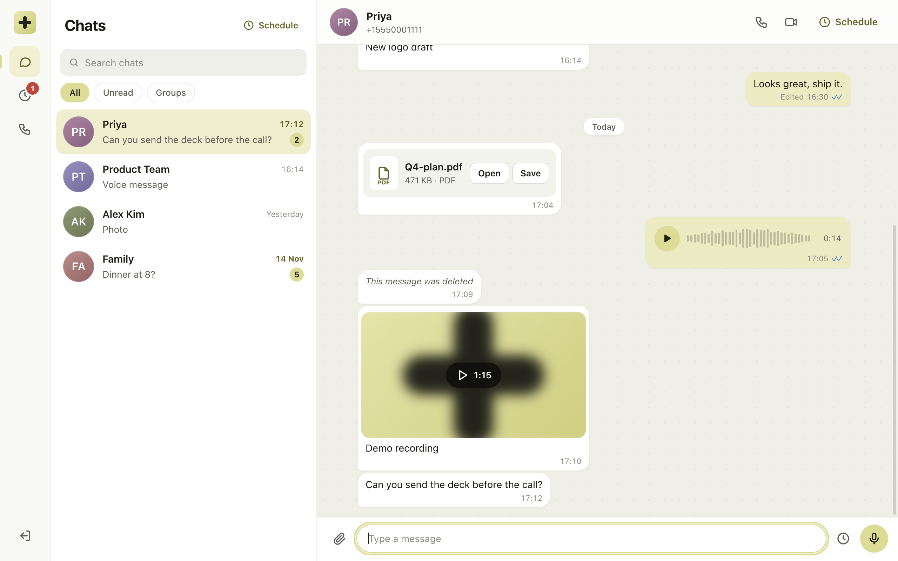
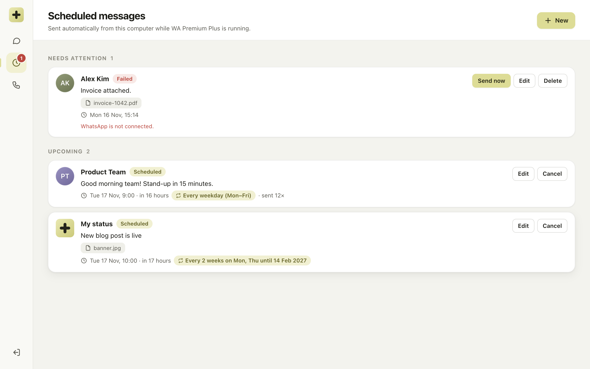
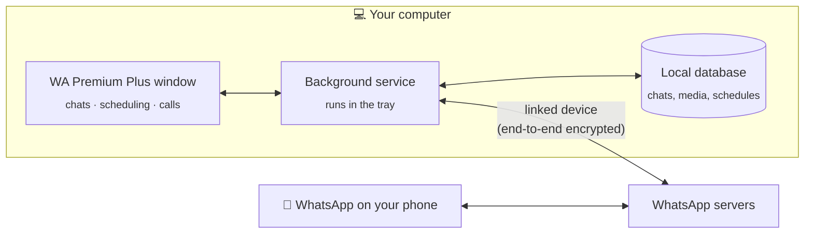

<div align="center">


# WA Premium Plus

**WhatsApp on your desktop, with superpowers.**

Schedule messages, statuses and group settings, send to many chats at once,<br>
and chat with your full history: photos, voice notes and documents included. Free and open source.

[](https://github.com/imbikramsaha/WA-Premium-Plus/actions/workflows/ci.yml)
[](https://github.com/imbikramsaha/WA-Premium-Plus/releases/latest)
[](LICENSE)


[**Download**](#download) · [What you can do](#what-you-can-do) · [How it works](#how-it-works) · [Privacy](#privacy-and-safety) · [FAQ](#faq)

<br>

<picture>
  <source media="(prefers-color-scheme: dark)" srcset="docs/screenshots/chat-dark.png">
  
</picture>

</div>

---

## Download

<table>
<tr>
<th align="center" width="33%">macOS</th>
<th align="center" width="33%">Windows</th>
<th align="center" width="33%">Linux</th>
</tr>
<tr>
<td align="center"><a href="https://github.com/imbikramsaha/WA-Premium-Plus/releases/latest/download/WA-Premium-Plus-mac-arm64.dmg"><b>Download for Apple silicon</b></a><br><a href="https://github.com/imbikramsaha/WA-Premium-Plus/releases/latest/download/WA-Premium-Plus-mac-x64.dmg">Download for Intel</a><br><sub>macOS 12 or later</sub></td>
<td align="center"><a href="https://github.com/imbikramsaha/WA-Premium-Plus/releases/latest/download/WA-Premium-Plus-windows-setup.exe"><b>Download for Windows</b></a><br><sub>Windows 10 &amp; 11 · x64<br>no admin rights needed</sub></td>
<td align="center"><a href="https://github.com/imbikramsaha/WA-Premium-Plus/releases/latest/download/WA-Premium-Plus-linux-amd64.deb">.deb</a> · <a href="https://github.com/imbikramsaha/WA-Premium-Plus/releases/latest/download/WA-Premium-Plus-linux-x64.AppImage">AppImage</a> <sub>(x64)</sub><br><a href="https://github.com/imbikramsaha/WA-Premium-Plus/releases/latest/download/WA-Premium-Plus-linux-arm64.deb">.deb</a> · <a href="https://github.com/imbikramsaha/WA-Premium-Plus/releases/latest/download/WA-Premium-Plus-linux-arm64.AppImage">AppImage</a> <sub>(ARM64)</sub></td>
</tr>
</table>

Or install with one command. It picks the right download for your computer, verifies it and starts the app:

**macOS and Linux**

```sh
curl -fsSL https://github.com/imbikramsaha/WA-Premium-Plus/releases/latest/download/install.sh | sh
```

**Windows** (PowerShell)

```powershell
irm https://github.com/imbikramsaha/WA-Premium-Plus/releases/latest/download/install.ps1 | iex
```

<details>
<summary><b>More install options</b></summary>
<br>

| Option | How |
|---|---|
| A specific version | Set `WAPP_VERSION=0.4.2` before the install command (PowerShell: `$env:WAPP_VERSION='0.4.2'`), or browse [all releases](https://github.com/imbikramsaha/WA-Premium-Plus/releases) |
| Linux without root | `curl -fsSL …/install.sh \| WAPP_FORMAT=appimage sh` installs the AppImage in your home folder. Other distributions get the AppImage automatically |
| Install without starting | Set `WAPP_NO_LAUNCH=1` |
| Build it yourself | See [docs/DEVELOPMENT.md](docs/DEVELOPMENT.md) |

The install commands check every download against the release's `SHA256SUMS`.

**The builds aren't code-signed yet** (that needs paid Apple and Microsoft certificates). If you download in a browser, macOS asks you to confirm the first launch in **System Settings → Privacy & Security → Open Anyway**, and Windows SmartScreen may show **More info → Run anyway**. The install commands avoid both prompts.

</details>

## Quick start

1. **Install WA Premium Plus** with a download above or the one-line command.
2. **Link your WhatsApp.** On your phone, open WhatsApp → **Linked devices** → **Link a device**, and scan the QR code in the app.
3. **That's it.** Your chats sync in, and you can start chatting and scheduling.

## What you can do

### Chat like on your phone
- **All your chats** with unread counts, search, and **All / Unread / Groups** filters.
- **Send and receive messages** with delivery and read ticks; edited and deleted messages are marked as such.
- **Photos, videos, stickers, voice notes and documents**: view photos full size, play voice notes and videos, open or save documents.
- **Send photos, videos and documents** by attaching, dragging them in or pasting, with a caption.
- **Record and send voice notes.**
- **Your history, including media**: older photos and files are fetched from your phone when you open a chat, and expired files are requested again.
- **Groups** show who said what, with a group info panel listing members, admins and the group's settings.
- **Desktop notifications** for new messages.

### Schedule anything
- **Messages**: write now, send later. To one chat or **many chats at once** (each gets its own copy), with an optional **photo, video or document**.
- **Status updates**: post text, a photo or a video to your status at a set time.
- **Group settings** (for groups you admin): who can send messages, who can edit info or add members, approval for new members, disappearing messages, the group name and description, and resetting the invite link.
- **Repeats**: every day, every weekday, weekly, monthly, yearly, or custom (every *N* days, weeks or months on the days you pick), with an optional end date.
- **Switch back automatically** for on/off group settings. For example, *only admins can send messages* every night from 22:00 to 07:00, set up in one step.
- **See before you save**: the next few send times are shown as you set things up.
- **Stay in control**: edit, cancel, delete or **Send now**. If the computer was off at the scheduled time, the message is marked *Missed* instead of going out hours late. Network hiccups are retried; problems that can't fix themselves (for example, no longer being a group admin) are reported with the reason.

### Calls
- **Voice and video calls** open the official WhatsApp Web in its own window, straight into the person's chat.

### Built for your desktop
- **Keeps running in the tray** when you close the window, so scheduled items still go out. Optional **Open at login** on macOS and Windows.
- **One app, one connection**: opening it twice brings back the window you already have instead of starting a second copy.
- **Light and dark themes** in Citrus, the yellow of Apple's MacBook Neo, with a native title bar on macOS.
- **Everything stays on your computer**: no accounts, no servers, no tracking.

<p align="center">
  
</p>

## How it works



WA Premium Plus links to your account as a **linked device**, the same way WhatsApp Web does, using [Baileys](https://github.com/WhiskeySockets/Baileys) (the open-source library behind [WAHA](https://github.com/devlikeapro/waha)'s NOWEB engine). Messages stay end-to-end encrypted between WhatsApp and your computer. Your chats, media and schedules are stored in a local database on your computer, and the scheduler runs in the background service, so it works with the window closed.

## Privacy and safety

| | |
|---|---|
| **Your data** | Chats, media and scheduled items live only on your computer. There are no WA Premium Plus servers, accounts or analytics. |
| **Your WhatsApp** | The app connects as a linked device; you can remove it any time from **Linked devices** on your phone, or with **Log out** in the app. |
| **Respectful by design** | No tricks that break other people's privacy: no keeping messages the sender deleted, no saving view-once media. |
| **Use it responsibly** | This is an unofficial client. Normal use is fine, but sending large volumes of messages, especially to people who haven't messaged you, can get a number banned by WhatsApp. |

## Platform support

| | macOS | Windows | Linux |
|---|---|---|---|
| **Versions** | 12 Monterey and later | 10 and 11 | Ubuntu 22.04+, Debian 12+ (.deb); other distributions via AppImage |
| **Processors** | Apple silicon, Intel | x64 | x64, ARM64 |
| **Tray** | Menu bar | System tray | System tray (GNOME needs the AppIndicator extension) |
| **Open at login** | ✓ | ✓ | Use your desktop's startup settings |

## FAQ

<details>
<summary><b>Is this an official WhatsApp app?</b></summary>
<br>
No. WA Premium Plus is an independent, open-source project and isn't affiliated with WhatsApp or Meta. It connects to your account as a linked device, like WhatsApp Web.
</details>

<details>
<summary><b>Do scheduled messages go out if my computer is off?</b></summary>
<br>
No. They're sent from your computer, so keep WA Premium Plus running (it stays in the tray when you close the window, and can open at login). If the computer was off or asleep at the scheduled time, a one-off message is marked <i>Missed</i> after an hour rather than sent late; you can send it with one click. Repeating messages simply wait for their next time.
</details>

<details>
<summary><b>Why can't I open some older photos?</b></summary>
<br>
Opening a chat asks your phone to send its recent media again, and expired files are requested again automatically. Your phone needs to be online. If the phone no longer has a file, the app tells you to open it there.
</details>

<details>
<summary><b>How do voice and video calls work?</b></summary>
<br>
No open-source WhatsApp library supports call audio or video, so the call buttons open the official WhatsApp Web in its own window, straight into the person's chat. Link it once by scanning its QR code. Whether WhatsApp Web can make calls depends on WhatsApp's rollout for your account; if it can't, use the official WhatsApp desktop app for calls.
</details>

<details>
<summary><b>Can I schedule group settings for any group?</b></summary>
<br>
Only for groups where you're an admin; WhatsApp doesn't let other members change settings. The app checks this when the change is due and reports it if you're no longer an admin.
</details>

<details>
<summary><b>Where is my data stored, and how do I uninstall?</b></summary>
<br>

| | macOS | Windows | Linux |
|---|---|---|---|
| Chats, media, schedules | `~/Library/Application Support/WA Premium Plus` | `%APPDATA%\WA Premium Plus` | `~/.config/WA Premium Plus` |

Choose **Log out** in the app first to unlink it from your phone and delete its data. Then remove the app: move it to the Trash (macOS), use **Settings → Apps** (Windows), or `sudo apt remove wa-premium-plus` / delete `~/.local/share/wa-premium-plus` (Linux).
</details>

## Roadmap

- [x] **Chats, media, groups and calls** on macOS, Windows and Linux
- [x] **Scheduling** for messages, statuses and group settings, with repeats
- [ ] **Quick replies and automation rules** (keyword replies, away messages)
- [ ] **Multiple WhatsApp numbers** in one app
- [ ] **Code-signed builds and auto-update**

See the full [roadmap](docs/ROADMAP.md).

## Contributing

Bug reports, ideas and pull requests are welcome. See [docs/DEVELOPMENT.md](docs/DEVELOPMENT.md) for building, testing and the project layout. For larger changes, please open an issue first.

## License

WA Premium Plus is open source under the [MIT License](LICENSE).

<sub>WhatsApp is a trademark of WhatsApp LLC. WA Premium Plus is an independent project and is not affiliated with, endorsed by or sponsored by WhatsApp or Meta.</sub>
