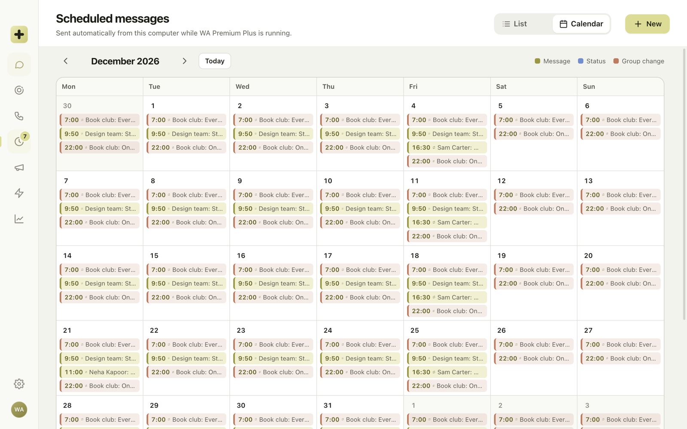
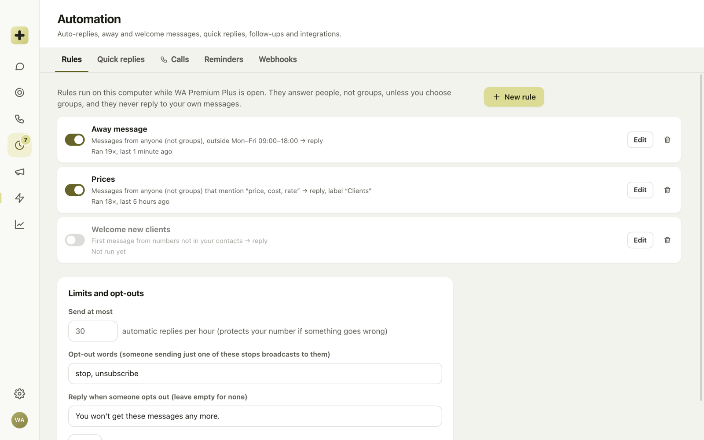
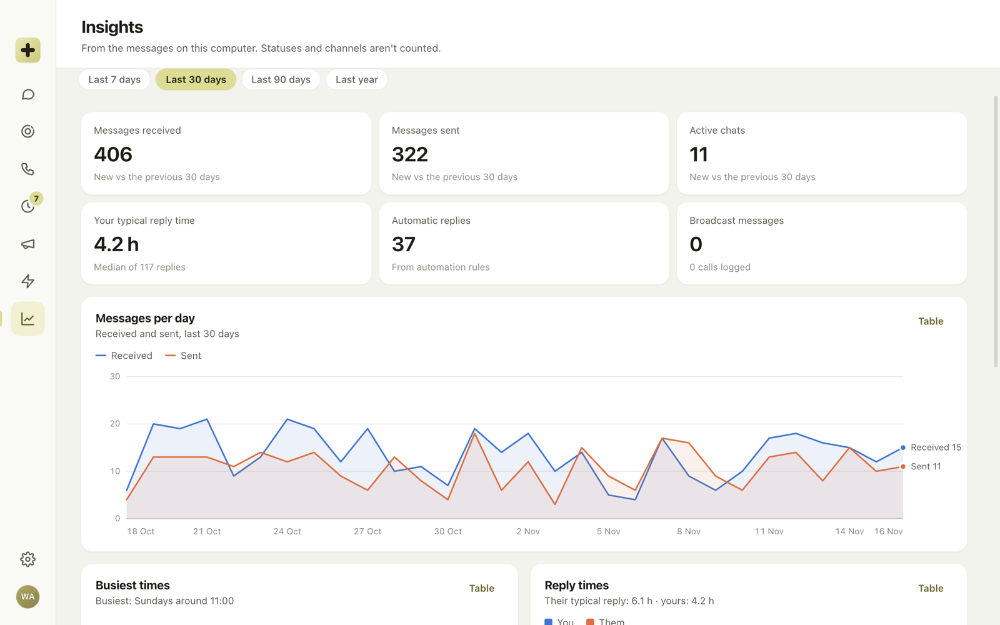
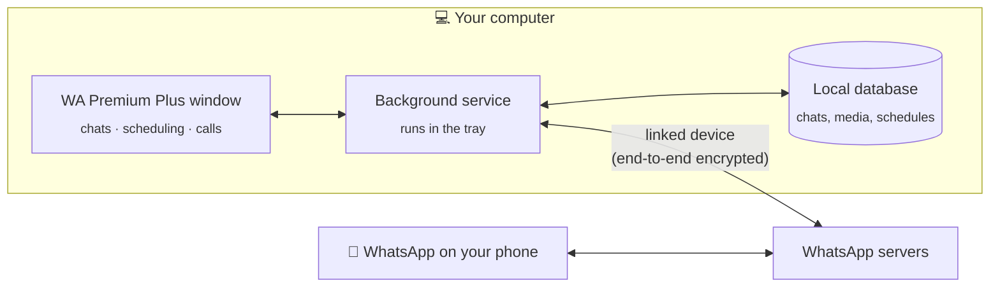

<div align="center">


# WA Premium Plus

**WhatsApp on your desktop, with superpowers.**

Schedule messages in anyone's time zone, automate replies, run safe broadcasts,<br>
search every chat and see your insights, with your full history on your computer. Free and open source.

[](https://github.com/imbikramsaha/WA-Premium-Plus/actions/workflows/ci.yml)
[](https://github.com/imbikramsaha/WA-Premium-Plus/releases/latest)
[](LICENSE)


[**Download**](#download) · [What you can do](#what-you-can-do) · [How it works](#how-it-works) · [Privacy](#privacy-and-safety) · [FAQ](#faq)

<br>

<picture>
  <source media="(prefers-color-scheme: dark)" srcset="docs/screenshots/chat-dark.png">
  
</picture>

</div>

---

## Download

<table>
<tr>
<th align="center" width="33%">macOS</th>
<th align="center" width="33%">Windows</th>
<th align="center" width="33%">Linux</th>
</tr>
<tr>
<td align="center"><a href="https://github.com/imbikramsaha/WA-Premium-Plus/releases/latest/download/WA-Premium-Plus-mac-arm64.dmg"><b>Download for Apple silicon</b></a><br><a href="https://github.com/imbikramsaha/WA-Premium-Plus/releases/latest/download/WA-Premium-Plus-mac-x64.dmg">Download for Intel</a><br><sub>macOS 12 or later</sub></td>
<td align="center"><a href="https://github.com/imbikramsaha/WA-Premium-Plus/releases/latest/download/WA-Premium-Plus-windows-setup.exe"><b>Download for Windows</b></a><br><sub>Windows 10 &amp; 11 · x64<br>no admin rights needed</sub></td>
<td align="center"><a href="https://github.com/imbikramsaha/WA-Premium-Plus/releases/latest/download/WA-Premium-Plus-linux-amd64.deb">.deb</a> · <a href="https://github.com/imbikramsaha/WA-Premium-Plus/releases/latest/download/WA-Premium-Plus-linux-x64.AppImage">AppImage</a> <sub>(x64)</sub><br><a href="https://github.com/imbikramsaha/WA-Premium-Plus/releases/latest/download/WA-Premium-Plus-linux-arm64.deb">.deb</a> · <a href="https://github.com/imbikramsaha/WA-Premium-Plus/releases/latest/download/WA-Premium-Plus-linux-arm64.AppImage">AppImage</a> <sub>(ARM64)</sub></td>
</tr>
</table>

Or install with one command. It picks the right download for your computer, verifies it and starts the app:

**macOS and Linux**

```sh
curl -fsSL https://github.com/imbikramsaha/WA-Premium-Plus/releases/latest/download/install.sh | sh
```

**Windows** (PowerShell)

```powershell
irm https://github.com/imbikramsaha/WA-Premium-Plus/releases/latest/download/install.ps1 | iex
```

<details>
<summary><b>More install options</b></summary>
<br>

| Option | How |
|---|---|
| A specific version | Set `WAPP_VERSION=0.4.2` before the install command (PowerShell: `$env:WAPP_VERSION='0.4.2'`), or browse [all releases](https://github.com/imbikramsaha/WA-Premium-Plus/releases) |
| Linux without root | `curl -fsSL …/install.sh \| WAPP_FORMAT=appimage sh` installs the AppImage in your home folder. Other distributions get the AppImage automatically |
| Install without starting | Set `WAPP_NO_LAUNCH=1` |
| Build it yourself | See [docs/DEVELOPMENT.md](docs/DEVELOPMENT.md) |

The install commands check every download against the release's `SHA256SUMS`.

**The builds aren't code-signed yet** (that needs paid Apple and Microsoft certificates). If you download in a browser, macOS asks you to confirm the first launch in **System Settings → Privacy & Security → Open Anyway**, and Windows SmartScreen may show **More info → Run anyway**. The install commands avoid both prompts.

</details>

## Quick start

1. **Install WA Premium Plus** with a download above or the one-line command.
2. **Link your WhatsApp.** On your phone, open WhatsApp → **Linked devices** → **Link a device**, and scan the QR code in the app.
3. **That's it.** Your chats sync in, and you can start chatting and scheduling.

## What you can do

### Chat like on your phone
- **All your chats** with unread counts, **pinned** chats on top, **archived** chats tucked away, **muted** chats kept quiet, and **All / Unread / Groups / Channels** filters. Pin, archive, mute and mark as unread sync with your phone.
- **Labels** of your own (Clients, Family, To follow up…) to sort and filter chats; WhatsApp Business labels sync in too.
- **Profile pictures** for people, groups and channels.
- **Reply, react, forward, edit and delete** messages, with delivery and read ticks, *bold*, _italic_ and clickable links.
- **Photos, videos, stickers, voice notes and documents**: view, play, open or save them; send them by attaching, dragging in or pasting; record voice notes.
- **Polls** (create, vote, see who voted), **locations** and **contact cards**.
- **Search every message** in every chat, in any language, and jump straight to the result.
- **Status**: see your contacts' updates and post your own text, photo or video.
- **Channels**: follow by link, read updates, mute or unfollow.
- **Groups**: who said what, members and admins, change settings and the name or description, add, remove, promote and dismiss members, reset the invite link, create and leave groups.
- **Call log** of calls received while the app runs and calls from your chat history.
- **Link by QR code or by phone number** (pairing code).
- **Several WhatsApp numbers** in one app, each with its own chats, schedules and automation, all connected at once.

<p align="center">
  
</p>

### Schedule anything
- **Messages**: write now, send later. To one chat or **many chats at once** (each gets its own copy), with an optional **photo, video or document**.
- **In the recipient's time zone**: "9:00 their time" is worked out from their phone number (or pick any time zone); with several recipients, each gets it at 9:00 *their* time. Repeats follow their clock through daylight-saving changes.
- **Status updates**: post text, a photo or a video to your status at a set time.
- **Group settings** (for groups you admin): who can send messages, who can edit info or add members, approval for new members, disappearing messages, the group name and description, and resetting the invite link, with **automatic switch-back** (for example *only admins can send* every night from 22:00 to 07:00).
- **Repeats**: every day, every weekday, weekly, monthly, yearly, or custom (every *N* days, weeks or months on the days you pick), with an optional end date.
- **Content calendar**: every upcoming send on a month grid, repeats included. Drag a one-off message to another day to move it; double-click a day to schedule on it.
- **Stay in control**: edit, cancel, delete or **Send now**. If the computer was off at the scheduled time, the message is marked *Missed* instead of going out hours late; problems that can't fix themselves (such as no longer being a group admin) are reported with the reason.

### Automate the routine
- **Quick replies**: type `/` in the message box to insert saved replies like `/thanks` or `/address`, with the person's name filled in.
- **Rules**: *when* a message arrives (from anyone, saved contacts, unknown numbers or chosen chats), *if* it mentions certain words or arrives outside business hours, *then* reply, add a label, mark it read or notify you. Ready-made **keyword replies**, **away messages**, **welcome messages** for new contacts and **welcome messages for people joining a group**.
- **Decline calls automatically** and send a message instead, for everyone or only unknown numbers, at any time or outside your hours.
- **Follow-up reminders**: "remind me if they haven't replied by Friday", or have the follow-up message sent for you. Settled automatically when they reply.
- **Broadcasts**: import contacts from a **CSV** file (or pick chats, or a group's members) and send each person a personalised message with `{first_name}`, any column from the file, and `{Hi|Hello}` variations.
- **Safety limits built in**: a daily cap, random pauses between messages, sending hours, a WhatsApp check on every number, an hourly limit on automatic replies, and **opt-outs**: anyone who replies STOP is never messaged again.
- **Webhooks** for n8n, Zapier, Make or your own server: new messages, calls, scheduled sends, broadcasts, opt-outs and reminders, as signed JSON.

<p align="center">
  
</p>

### Understand your chats
- **Insights**: messages sent and received per day, your busiest days and hours, your most active chats, and how quickly you and others reply. Every chart has a table view.
- **Export** a chat, or all of them, as text (like WhatsApp's own export), a web page, CSV or JSON, with the photos and files already on your computer.
- **Export a group's members** as a CSV file.

<picture>
  <source media="(prefers-color-scheme: dark)" srcset="docs/screenshots/insights-dark.png">
  
</picture>

### Built for your desktop
- **Updates itself**: new versions download in the background from GitHub Releases, are checked against their published SHA-256 checksums, and install when you restart. (Linux .deb installs show the one-line update command.)
- **Keeps running in the tray** when you close the window, so scheduled messages, rules and broadcasts still run. Optional **Open at login** on macOS and Windows.
- **One app, one connection**: opening it twice brings back the window you already have.
- **Light and dark themes** in Citrus, the yellow of Apple's MacBook Neo, with a native title bar on macOS.
- **Everything stays on your computer**: no accounts, no servers, no tracking.

## How it works



WA Premium Plus links to your account as a **linked device**, the same way WhatsApp Web does, using [Baileys](https://github.com/WhiskeySockets/Baileys) (the open-source library behind [WAHA](https://github.com/devlikeapro/waha)'s NOWEB engine). Messages stay end-to-end encrypted between WhatsApp and your computer. Your chats, media and schedules are stored in a local database on your computer, and the scheduler runs in the background service, so it works with the window closed.

## Privacy and safety

| | |
|---|---|
| **Your data** | Chats, media and scheduled items live only on your computer. There are no WA Premium Plus servers, accounts or analytics. Webhooks send events only to the addresses you add, and update checks only ask GitHub for the latest version. |
| **Your WhatsApp** | The app connects as a linked device; you can remove it any time from **Linked devices** on your phone, or with **Log out** in the app. |
| **Respectful by design** | No tricks that break other people's privacy: no keeping messages the sender deleted, no saving view-once media. |
| **Use it responsibly** | This is an unofficial client. Normal use is fine, but sending large volumes of messages, especially to people who haven't messaged you, can get a number banned by WhatsApp. Broadcasts and auto-replies have safety limits on by default; keep them. |

## Platform support

| | macOS | Windows | Linux |
|---|---|---|---|
| **Versions** | 12 Monterey and later | 10 and 11 | Ubuntu 22.04+, Debian 12+ (.deb); other distributions via AppImage |
| **Processors** | Apple silicon, Intel | x64 | x64, ARM64 |
| **Tray** | Menu bar | System tray | System tray (GNOME needs the AppIndicator extension) |
| **Open at login** | ✓ | ✓ | Use your desktop's startup settings |

## FAQ

<details>
<summary><b>Is this an official WhatsApp app?</b></summary>
<br>
No. WA Premium Plus is an independent, open-source project and isn't affiliated with WhatsApp or Meta. It connects to your account as a linked device, like WhatsApp Web.
</details>

<details>
<summary><b>Do scheduled messages go out if my computer is off?</b></summary>
<br>
No. They're sent from your computer, so keep WA Premium Plus running (it stays in the tray when you close the window, and can open at login). If the computer was off or asleep at the scheduled time, a one-off message is marked <i>Missed</i> after an hour rather than sent late; you can send it with one click. Repeating messages simply wait for their next time.
</details>

<details>
<summary><b>Why can't I open some older photos?</b></summary>
<br>
Opening a chat asks your phone to send its recent media again, and expired files are requested again automatically. Your phone needs to be online. If the phone no longer has a file, the app tells you to open it there.
</details>

<details>
<summary><b>How do voice and video calls work?</b></summary>
<br>
No open-source WhatsApp library supports call audio or video, so the call buttons open the official WhatsApp Web in its own window, straight into the person's chat. Link it once by scanning its QR code. Whether WhatsApp Web can make calls depends on WhatsApp's rollout for your account; if it can't, use the official WhatsApp desktop app for calls.
</details>

<details>
<summary><b>Can I schedule group settings for any group?</b></summary>
<br>
Only for groups where you're an admin; WhatsApp doesn't let other members change settings. The app checks this when the change is due and reports it if you're no longer an admin.
</details>

<details>
<summary><b>Are broadcasts safe for my number?</b></summary>
<br>
Broadcasts go out one at a time with random pauses, within the hours and the daily limit you set, only to numbers that are on WhatsApp, and never to people who opted out. That keeps them close to how a person sends messages. Still, WhatsApp may ban numbers that message many people who don't know them, so only message people who expect to hear from you, and keep the opt-out line in.
</details>

<details>
<summary><b>How do updates work without a code-signing certificate?</b></summary>
<br>
The app asks GitHub for the latest release a few times a day, downloads the installer for your computer, and checks it against the release's <code>SHA256SUMS</code> before installing it when you restart. On macOS the new app replaces the old one in place; on Windows the installer runs silently; AppImages replace themselves. If you installed the Linux .deb, it shows the one-line command to update instead. You can turn automatic checks off in Settings.
</details>

<details>
<summary><b>Can I use two WhatsApp numbers?</b></summary>
<br>
Yes. Click your picture at the bottom left and choose <b>Add WhatsApp account</b>. Every account stays connected in the background with its own chats, schedules, rules and broadcasts; notifications say which account they're for.
</details>

<details>
<summary><b>Where is my data stored, and how do I uninstall?</b></summary>
<br>

| | macOS | Windows | Linux |
|---|---|---|---|
| Chats, media, schedules | `~/Library/Application Support/WA Premium Plus` | `%APPDATA%\WA Premium Plus` | `~/.config/WA Premium Plus` |

Choose **Log out** in the app first to unlink it from your phone and delete its data. Then remove the app: move it to the Trash (macOS), use **Settings → Apps** (Windows), or `sudo apt remove wa-premium-plus` / delete `~/.local/share/wa-premium-plus` (Linux).
</details>

## Roadmap

- [x] **Chats, media, groups, status, channels and calls** on macOS, Windows and Linux
- [x] **Scheduling** for messages, statuses and group settings, in anyone's time zone, with a calendar
- [x] **Automation**: quick replies, rules, call auto-reject, follow-ups, broadcasts with safety limits, webhooks
- [x] **Data**: search everything, export chats and members, insights
- [x] **Multiple WhatsApp numbers** and **auto-update**
- [ ] **AI helpers** (bring your own key): suggested replies, summaries, voice-note transcription
- [ ] **Code-signed builds** (needs paid Apple and Microsoft certificates)

See the full [roadmap](docs/ROADMAP.md).

## Contributing

Bug reports, ideas and pull requests are welcome. See [docs/DEVELOPMENT.md](docs/DEVELOPMENT.md) for building, testing and the project layout. For larger changes, please open an issue first.

## License

WA Premium Plus is open source under the [MIT License](LICENSE).

<sub>WhatsApp is a trademark of WhatsApp LLC. WA Premium Plus is an independent project and is not affiliated with, endorsed by or sponsored by WhatsApp or Meta.</sub>
